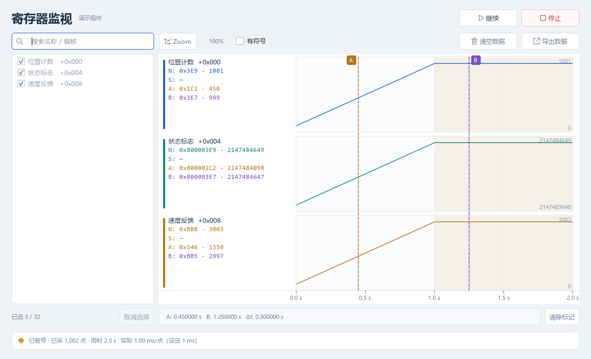
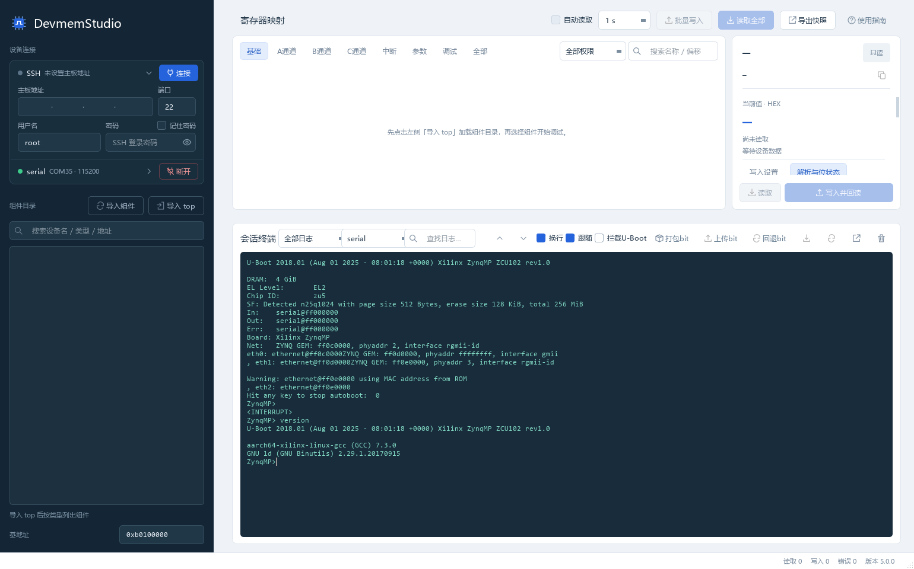
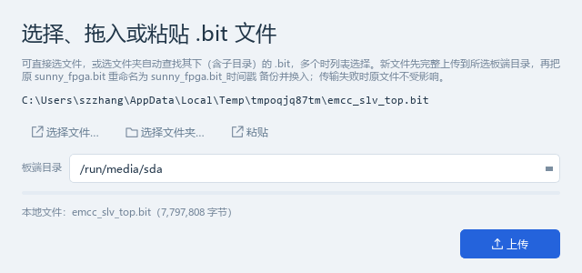
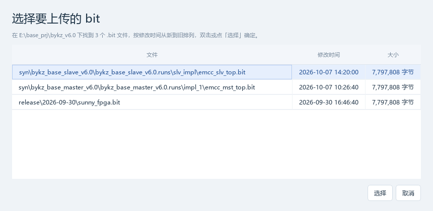
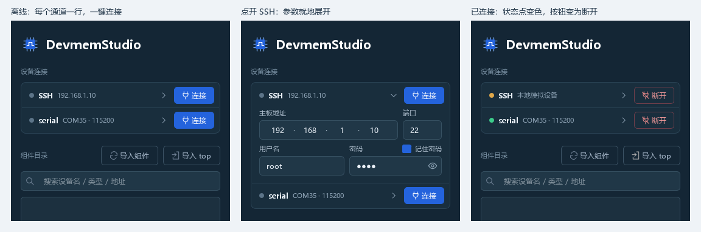
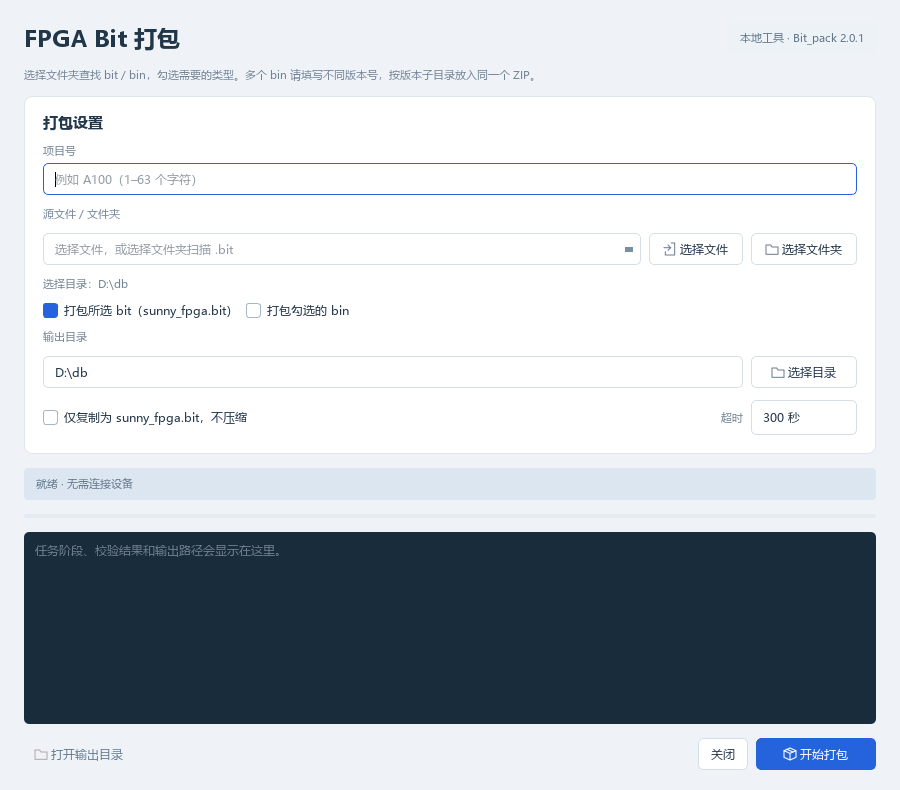
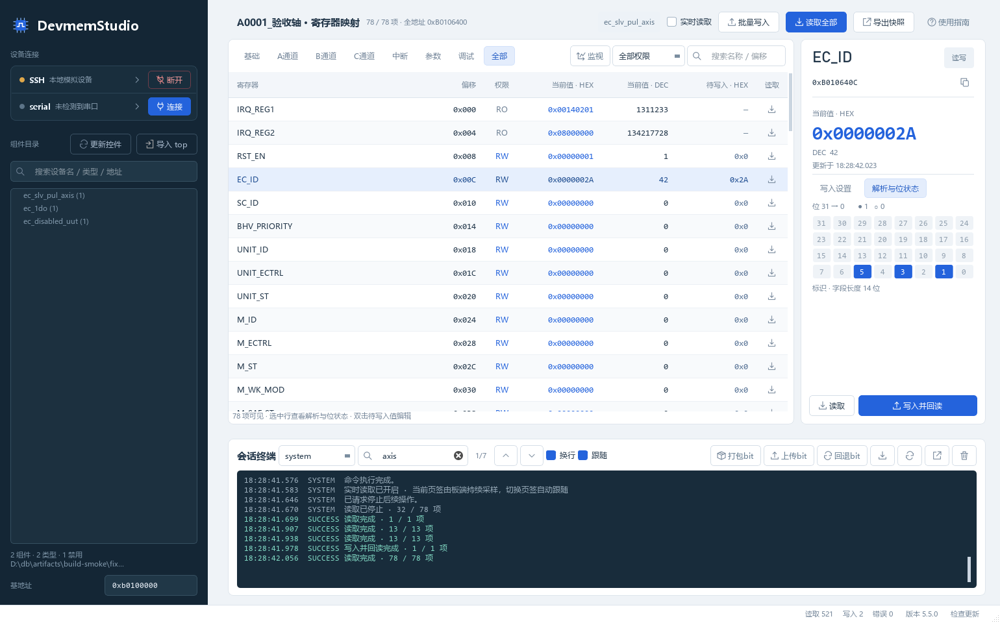
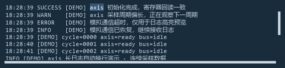
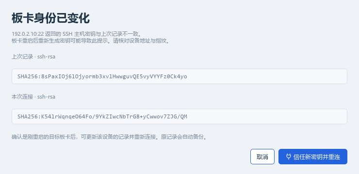

# DevmemStudio 变更记录

本文件是 [README](../README.md) 的历史变更记录：5.5.9 及更早版本的发布变化，按版本从新到旧排列。当前版本的变化见 [5.5.10 发布](../README.md#5510-发布2026-10-24)。

## 5.5.9 发布（2026-10-23）

- **「回退bit」新增「下载到本地」**：在备份列表选择某个版本，点「下载到本地」即可把该版本保存到本机，板端文件保持不变。
- 自动生成便于再次上传的文件名：`sunny_fpga.bit_20260918010203` → `sunny_fpga_20260918_010203.bit`（保留 `.bit` 后缀可直接用于「上传bit」）；记住上次选择的下载目录；进度条显示下载进度；非破坏性操作无需板端确认。

## 5.5.8 发布（2026-10-22）

- **PARAM 寄存器显示板端 DI/DO 接线**：导入 top 后，参数寄存器现在会解析并显示其组件端口接到的板端 DI/DO 总线信号（如 `PARAM68 · i_axis_zero/origin · ~di_mst_msg[0]`）。
- 接线跟随纯别名连线追溯：直接连接、经一根网线转接、拼接别名（`assign {o_dri2,o_dri1} = do_o`）都能追到真实端口，位选与取反保留原样；接线纳入上下文缓存，同一类型不同实例接线不同时不会串用。
- 组件目录随 RTL 重新生成，参数寄存器记录其组件端口（`ports` 字段）。

## 5.5.7 发布（2026-10-20）

- **多组件同时监视**：每个组件一个监视窗口，可同时打开多个组件一起监视；窗口标题带组件名，新窗口自动级联错开，各窗口的勾选与设置互相独立。
- **停止/暂停立即生效**：停止、暂停或关闭时会立即终止板端采样通道（板端进程随 SIGPIPE 退出），不再等到下一个采样周期；会话断开时同样立即终止所有监视通道。
- **RTL 解析与寄存器表增强**：注释扫描识别 Verilog 字符串与转义标识符（字符串内 `/*`、`//` 不再误开注释）；读臂解析覆盖全部 case 块、支持字节/半字切片与标签列表；写检测支持 begin/end 块内首语句非写的情况；条件编译分支重复定义给出告警；无 `REG_SPACE_BIAS` 的无参数例化不再崩溃。
- **连接与升级**：串口连接改为专属线程池；升级助手新增**可选签名固定**（`DEVMEMSTUDIO_EXPECTED_SIGNER`）；下载残留与旧版备份按保留策略自动清理；板端采样程序清理保护近期使用中的文件。

## 5.5.6 发布（2026-10-19）

- **寄存器监视与实时读取扩展至 64 路**：监视窗口与实时读取的寄存器上限从 32 提升到 64（与板端常驻采样程序 regmon 的 64 寄存器上限一致），内存预算按路数自动折算保持不变；实时读取不再重复打印截断提示。

## 5.5.5 发布（2026-10-19）

- **按位宽读写寄存器**：支持按 8-bit、16-bit、32-bit、64-bit 访问位宽读写寄存器（`devmem` 宽度参数 `8`/`16`/`32`/`64`），写入设置与批量写入面板联动位宽选择器，支持 64 位大数掩码截断与溢出保护。
- **串口扫描专属线程池解耦**：COM 串口异步扫描探测从全局共享线程池剥离至专属单工作线程池（`ports_pool`），彻底消除图表监控密集采样与高频读写时的线程饥饿与界面卡顿。
- **顶层模块解析与实例化增强**：无参数例化模块（parameterless instance）支持精确提取端口映射与基地址，避免同名/重名覆盖；RTL 端口与信号高阻态/通配符清洗规则优化并抑制重复告警。
- **寄存器写入草稿真 LRU 记忆**：优化寄存器输入状态保留策略，草稿列表采用严格访问顺序 LRU 淘汰机制，并智能保留未提交改动的草稿。
- **升级助手与后台调度优化**：优化升级调度轮询频率，消除退出与轮询时的忙等待，减少后台 CPU 占用。

## 5.5.4 发布（2026-10-16）

- **凭据 DPAPI 加密与 SSH 首次信任核验**：`registers.json` 中的 SSH 密码及串口密码采用 Windows DPAPI（`dpapi:v1:`）加密存储，启动时自动无缝迁移旧版明文；SSH 连接由原先隐式自动信任改为严格未知主机拒绝策略，首次连接未知板卡弹出确认框核对指纹后才写入信任列表（`known_hosts`）；板端常驻采样程序放置增加全局可写防护与完整性校验。
- **升级助手与构建便携性**：升级助手脚本（`apply_update.ps1`）哈希计算改用原生 .NET `SHA256`，适配受限语言与无内置实用模块环境；组件目录生成器与发布脚本支持便携 RTL 路径与可靠发布暂存。
- **界面与系统兼容优化**：响应式工具栏引入状态缓存降低重绘开销；串口自动扫描周期由 3 秒延长至 20 秒；适配 Windows 现代 Shell 对 `ITaskbarList::HrInit` 的实现变化，保证任务栏单图标与窗口联动正常。

## 5.5.3 发布（2026-10-16）

- 监视缓冲按寄存器数量控制历史点数，生产运行延迟创建有符号值缓冲，减少多通道长时间监视的内存占用；`devmem` 回退循环在低于 5 ms 时自动限速，aarch64 常驻采样仍支持 1 ms。
- 新增预览优先的工作区清理工具，按版本和文件年龄清理历史发布包、验收产物与旧日志，不触碰源码、配置和 `venv`。
- 新增依赖锁定、源码编译与组件目录快速检查，支持严格目录完整性门槛和 Windows CI；新增对应回归测试。

## 5.5.2 发布（2026-10-16）

- 修复停止监视后的曲线错位：采样缓冲固定本次运行的寄存器顺序，空闲图表和清空数据始终按该顺序取列；新增对应回归测试。

## 5.5.1 发布（2026-10-15）

- 寄存器监视新增**采样间隔设置**：监视窗口标题行加入采样间隔输入框（1–60000 ms，默认 5 ms），运行与暂停期间锁定、下次开始监视时生效；选择的间隔持久化到配置，重启后保留。
- 监视按钮与工具提示、状态栏说明随设定间隔动态更新；固定 1 ms 时代移除的间隔设置恢复为可调，并保留暂停/恢复与实时读取行为。

## 5.5.0 发布（2026-10-15）

- 当前寄存器视图新增「实时读取」：由板端常驻采样程序按固定 5 ms 周期刷新，切换页签和搜索结果自动跟随；每次启动默认关闭，写入流程保持独立；读有副作用、只写或读清零的寄存器不会加入实时读取，避免后台刷新改变寄存器行为。
- 监视采样周期固定为 1 ms，移除容易造成误解的间隔输入框；常驻 `regmon` 无法执行时回退到 `devmem` 循环，并在状态栏说明实际采样方式。
- 支持暂停/恢复：暂停期间保留已有数据，恢复后继续画在同一条曲线上；板端时钟回拨、网络短暂停顿和读取失败不会破坏已有曲线。
- 曲线绘制使用分段缓存与多级极值缓存，密集数据按可见像素绘制；Ctrl + 滚轮缩放平滑过渡、鼠标锚点保持不变；暂停区域以时间轴背景标记。
- 更新监视帮助、状态提示和离线演示数据。详细记录见 [5.5.0 验收记录](VALIDATION_5.5.0.md)。

## 5.4.3 发布（2026-10-15）

- 监视支持按住鼠标中键实时平移时间视图，拖动过程按当前采样数据刷新曲线，结束后继续使用缓存帧，减少大量采样数据下的重绘等待；保留当前视野与采样数据，拖动时不会因新数据到达而跳回最新位置。
- SSH 地址分段输入支持句点跳转、整段连续删除，以及跨段 Backspace/Delete，键盘布局变化时仍能正确识别句点。
- 长路径、打包窗口和窄窗口布局使用省略显示与自适应尺寸，完整路径保留在提示中，不再撑高输入行或遮挡按钮；主窗口在多屏、最大化和恢复之间保存并恢复可见的普通位置与尺寸，避免窗口恢复到屏幕外。
- 刷新内置组件寄存器目录，随 5.4.3 发布包提供最新的 RTL 组件定义；运行时导入控件和旧版覆盖定义规则保持不变。

## 5.4.2 发布（2026-10-13）

- 任务栏只保留一个工作台图标，按钮直接对应最后最小化的窗口，由 Windows 原生恢复；最大化恢复后同步内容区尺寸并完整重绘，避免只显示原来的小窗口区域。
- SSH 网络失败或超时后持续重试，直到连接成功或点击「取消」；网络连接阶段最多等待 2 秒，SSH banner 阶段最多等待 1 秒，完整 SSH 协商最多等待 5 秒，失败后主动 shutdown 并关闭半连接，以 100 ms 起步、逐次加倍（上限 2 秒）的间隔重新尝试，支持先断网、再恢复连接；认证失败（用户名或密码错误）会立即停止重试并提示。连接期间组件目录可以上下滚动和搜索。
- 「打包bit」选择文件夹时递归查找 bit / bin：可分别勾选两种文件，bin 保留原文件名；选择多个 bin 时填写不同版本号，按版本子目录合并到一个 ZIP。仅复制模式仍用于 bit。
- 寄存器监视勾选在按下鼠标时立即响应；上下滚动期间继续刷新曲线、最新值与时间轴。
- Ctrl + 滚轮缩放取消固定 64 倍上限，最小时间窗口为两倍采样间隔，长时间采样后也可以查看细节；鼠标位置对应的时间保持不变。
- bit 打包超时输入框与「选择目录」按钮等宽，「打包勾选的 bin」不再显示尾部备注。
- 主窗口和子窗口保存的是最大化之前的普通尺寸；软件关闭后再次启动、再点还原时，回到原来的小窗口大小，不把最大化尺寸当作普通尺寸。
- 右下角版本号和「检查更新」使用同一条文字基线，避免链接文字上下错位。
- 会话日志、板端日志下载、寄存器快照和监视 CSV / ZIP 的默认文件名统一使用下划线，时间戳格式为 `YYYYMMDD_HHMMSS`。

## 5.4.1 发布（2026-10-12）

- 寄存器监视「按时间段导出」交互增强：选区左右边缘可直接拖动调整范围（边缘出现调整手柄，光标变为左右箭头，可拖过对侧翻转选区）；在选区外按住左键拖动重新选择，在选区内点击保持原选区；选区高亮与边缘线只绘制可见区域，滚动/缩放时始终对齐曲线。
- 新增选区边缘调整、拖动重新选择、跨越翻转与越界钳制的回归测试。

## 5.4.0 发布（2026-10-12）

- 调试页签补全 `DEBUG_REG4/5`：`ec_slv_pul_axis` 等控件新启用的调试寄存器（帧计数/控制标志）不再只出现在「全部」页签，更新控件后「调试」页签一并显示；悬停说明同步更新。
- 寄存器监视支持按时间段导出：在曲线图上按住左键拖选时间范围（蓝色高亮选区），点「导出数据」只导出该范围内的采样点；未选择时仍导出全部保留数据，右键清除选区。选区按采样时间精确切分，读取失败的空值行在选区内同样正确对齐。
- 打包内置寄存器表随最新 RTL 刷新：`ec_slv_pul_axis` 增加 `DEBUG_REG4/5` 与 `PARAM54/55`（m2s/s2m word0）寄存器定义。

## 5.3.9 发布（2026-10-11）

- 升级流程强化：升级助手启动前检测执行策略（PowerShell 受限语言模式下保留应用并提示手动下载）；新版 EXE 替换后等待其真正启动（出错弹窗或未启动自动回滚并恢复旧版）；替换增加重试与明确失败提示；安装目录含 `[ ]` 等特殊字符也可正常升级。升级残留清理与结果读取接口已实现并通过测试，本版本暂未在应用内启用（后续版本接入）。
- SSH 会话更健壮：命令超时或用户取消时以 Ctrl+C 中断命令并保留会话（不再强制断连）；连接被拒（端口未开放/SSH 未启动）明确提示；关闭连接即取消正在进行的连接；板端更换主机密钥时只保留最近 5 份备份。
- 寄存器监视增强：板端长时间无数据自动停止（网络或板子断开）；板端时钟倒退时按偏移修正时间轴（不再因手动校时停止）；板端无 `date +%N` 时按采样间隔铺开时间点；读取中断时补齐截断点；采样睡眠策略自动降级（usleep → 小数秒 → 整秒，绝不忙等）。
- 寄存器解析增强：地址表支持十进制/纯数字定义并对重复定义告警；写入检测支持 `if` 形式与高位填充拼接；读取宽度扣除两端常数填充；读 mux 外触发的寄存器（如 FIFO 弹出、读清零）标记为「读有副作用」，界面与监视永不自动读取；组件导入记录导入时间（备份恢复后仍按导入时间与内置表取舍）。
- 界面改进：IP 地址输入支持点号跳格、整段粘贴、去前导零（避免按八进制解析），地址不完整时提示；上传/回退 bit 的确认框前后校验连接状态，弹窗打开期间暂停自动读取；串口连接按钮兼作取消；top 解析支持块注释后代码保持有效、单行实例优先于注释模板。
- bit 打包健壮性：网络共享短读容错、多个清理失败逐条提示、跳过目录链接（junction）、错误信息更明确。
- 构建与发布：单文件 EXE 可重现构建（时间戳确定、链接器去插入时间戳、压缩缓存按代码指纹失效）；发布脚本校验 EXE 版本与声明版本一致才打包（防止旧 EXE 进新版 ZIP 导致客户端永远提示升级）；构建并行步骤失败时联动取消其余步骤。

## 5.3.8 发布（2026-10-11）

- 界面术语调整：原「导入组件」改名为「更新控件」（按钮、提示、帮助文本、README 统一），含义不变。
- 重新打包发布时自动从 RTL 重新生成组件寄存器表（`tools/build.py` 打包前运行 `gen_component_catalog.py --refresh`）：按表内记录的 RTL 根目录（或环境变量 `DEVMEMSTUDIO_RTL`）重新生成，top 自动取 `<RTL>/top` 下全部含 `ec_` 控件的文件，RTL 已删除的旧类型保留（老 bit 仍在使用）；内容无变化且本机没有更新的「更新控件」结果时不改写文件，RTL 目录不存在时跳过并沿用现有表，存在未解析文件或 top 类型无法匹配时构建失败；`--no-catalog` 可跳过此步。
- 组件寄存器表随 RTL 更新：`ec_2di_2do` 等类型的 `DEBUG_REG2` 位快照字段（`irq_posedge_cnt` / `irq_negedge_cnt`）已随 RTL 断开，行为表注释相应更新；新增 `ec_sg_rfid`、`ec_sp_rfid`、`ec_osm41_485_laser_distance` 组件类型。
- 新增「构建刷新寄存器表」行为测试（保留旧类型、无变化不改写、本机更新结果优先等）。

## 5.3.7 发布（2026-10-10）

- 更新窗口的更新说明改回左对齐并完善排版：版本标题（蓝色）与分类标题层级清晰、行距调整，说明中的代码片段以等宽字体（Consolas）显示并加背景高亮。
- 更新窗口内不再显示「升级方式 / 校验 / 验证」等发布页专用段落，只列出各版本的改动内容；GitHub 发布页上的说明不受影响。

## 5.3.6 发布（2026-10-10）

- 更新窗口一次列出当前版本之后到最新版本的**每个正式版说明**（新版在前），不再只显示最新一版；GitHub API 受限时改读发布页订阅 `releases.atom` 获取说明（同样不占 API 额度），取不到时提示到发布页查看。
- 本地组件定义与内置表按新旧取舍：在线升级后，新版内置表生成时间晚于本地定义文件时以内置表为准，之后再导入的定义仍优先。
- 位置族信号修正 `PARAM4`（除数本身 / Touch 速度）显示：始终按 1 unit/s 显示，不再套用位置单位。

## 5.3.5 发布（2026-10-10）

- 「导入 top」先列出扫描到的 top（路径、控件数量、修改时间，只有一个结果也列出），选择后再确认导入。
- 「导入组件」先列出组件目录、类型和寄存器定义文件（只有一个结果也列出），默认全选，可取消不需要的组件；点「选择」仅解析所选组件，再确认导入，取消列表不会解析或导入。
- 「导入 top」与「导入组件」分别记住上次选择的文件夹，重启后保留；选择文件夹即更新记忆，记忆目录不存在时回退到已导入 top 所在目录，再不行使用系统默认位置。

## 5.3.4 发布（2026-10-10）

- 同一标记线位置再次按下鼠标立即取消该标记，并同步刷新标记与读数，不再等待松开鼠标或曲线重算；按住已有标记拖动时继续调整位置，拖到无效区域时保留最后的有效标记。
- 持续采样时上下滚动优先移动画面：未显示过的曲线逐行补齐并提前准备相邻行，滚动期间仍接收和保留采样，停止滚动后继续刷新最新数据；密集曲线按每个像素列的完整极值绘制，保留短脉冲，减少同一列的重复绘制。

## 5.3.3 发布（2026-10-10）

- 停止监视后，图表曲线改为跟随左侧勾选的寄存器：勾选、取消勾选或切换组件时曲线立即更新；上次运行中有数据的寄存器继续显示其采样，无数据的车道显示「—」，缩放与 A/B 标记保持不变。
- 只改变勾选时不再重置缩放或清空数据，曲线定位保持当前视野。

## 5.3.2 发布（2026-10-10）

- 更新窗口的更新说明改为整体居中显示：说明正文、分类标题和列表项左右留白一致；窗口顶部「更新说明」标题同步居中。

## 5.3.1 发布（2026-10-10）

- 读取失败时，最新值、鼠标值、A/B 标记读数明确显示「读取失败」，不再把内部保持的前值当作成功读取的结果；CSV 继续导出空值，并在曲线时间轴上用红色刻度标出失败点。
- 采样值改用 32 位整数数组，完整保留 0～0xFFFFFFFF 和补码有符号值；淘汰旧点时直接复用范围统计，不再重新扫描全部保留数据，20 万点追加淘汰耗时从约 305 ms 降到约 6 ms。
- 监视数据导出移到独立工作线程：选定保存位置后复制要导出的内容，导出期间可以继续采样、搜索、查看曲线或清空数据，后续变化不改变本次导出结果。
- ZIP 压缩等级从 9 调整为 6（仍为无损 DEFLATE，不改变 CSV 内容），压缩更快；两者导出内容逐字节一致。
- 后台分段绘制不再因每批新采样而重新开始，较慢机器或复杂曲线下画面不再长期停留在旧帧；只有一个采样点时显示圆点；监视期间也能搜索寄存器列表。
- A/B 标记：同一标记线位置再次单击取消该标记，删除后优先补回空缺，全部删除后从 A 开始；曲线行之间的空隙也能添加、取消和拖动标记。

## 5.3.0 发布（2026-10-10）

- 寄存器监视窗口「导出数据」可把保留的全部采样点导出为 **无损压缩 ZIP**（内含同名 CSV，Windows 自带解压即可打开）或普通 **CSV**，默认 ZIP。
- 主工作台的「导出快照」同样支持 ZIP 无损压缩与普通 CSV 两种格式，默认 ZIP。
- ZIP 解压后的 CSV 与普通 CSV 逐字节一致，保留全部导出行、列、中文、数值、有符号显示选择和读取失败的空值；只导出保留部分，监视缓存超限时已丢弃的旧数据不包含在内。
- 导出按文件名扩展名识别格式，未填写扩展名时按所选类型补齐；先写临时文件、成功后再替换目标文件，导出失败不会覆盖已有文件。

## 5.2.9 发布（2026-10-09）

- 开始监视后点击图表放置 A/B 标记，不再打断后续采样刷新，曲线不会停在点击那一帧。
- 子窗口最大化后，点击主窗口或任务栏可以把主窗口提到前面。子窗口保持最大化，再点它的任务栏按钮即可回到子窗口。

## 5.2.8 发布（2026-10-09）

- 寄存器监视最多 32 个寄存器。曲线较多时滚轮上下浏览，点击左侧寄存器定位对应曲线；只绘制当前可见曲线。开始监视后滚动不再因采样重绘而滞后。
- 时间轴固定在图表可视区域底部，曲线再多也能看到，并随新采样更新。鼠标时间显示在这条时间轴上。
- A/B 标记按当前画面上的点击位置放置。监视进行中新采样到来时，标记线不再偏到点击位置旁边。点 A/B 标签只选中该标记。
- 每条曲线左侧表头显示名称和地址，并固定显示 `N`（最新值）、`S`（鼠标读数）、A、B。未设置时显示「—」。A/B 标签只在可见图表顶部显示一组，随纵向滚动保持在顶部。图表不弹出使用说明气泡。
- 串口连接时「重启设备」通过串口发送 `reboot` 并保持连接以接收启动日志。SSH 与串口同时在线时，按终端来源选择通道，确认框写明发送通道。
- 子窗口最小化到任务栏，不再留下桌面小框。主窗口最小化时隐藏子窗口，恢复时保留各窗口原来的普通、最大化、最小化状态和位置。

## 5.2.7 发布（2026-10-09）

- 修复首次选择组件时，“自动读取”左侧组件类型名称偶发显示不全：标签宽度按完整名称稳定计算，去掉与样式内边距叠加的默认缩进。
- 寄存器标题栏空间不足时先收起操作按钮文字，优先完整显示组件标题和类型名称；仅在收起后仍不足时省略名称，悬停可查看全文。

## 5.2.6 发布（2026-10-08）

- 寄存器监视的勾选按组件类型记忆：在某个组件上勾选后，打开同类型的其他实例（如另一个 `ec_slv_pul_axis`）会按相同偏移自动勾选；该实例自己改过勾选后以它自己的为准。只打开、不改勾选不再写入记忆。
- README 中的图片和表格居中显示。

## 5.2.5 发布（2026-10-08）

- 更新窗口标题栏加入最小化（及最大化）按钮；最小化后再点“检查更新”或自动检查发现新版时，窗口会恢复显示。

## 5.2.3 发布（2026-10-08）

- 更新窗口点击“取消”或关闭窗口立即生效，不再等卡住的网络请求超时；取消后可马上重新检查。
- 升级后的旧版备份改名为 `DevmemStudio-<旧版本>-backup.exe`，双击即可运行旧版。原来的 `.bak` 会被公司透明加密，改回 `.exe` 也无法运行。从 5.2.2 升到本版时仍按旧规则生成 `.bak`，之后的升级才使用新名称。

## 5.2.2 发布（2026-10-08）

功能与 5.2.1 相同，用于验证从 5.2.1 在线升级的完整流程。

## 5.2.1 发布（2026-10-08）

5.2.0 未在 GitHub 发布，本版是在线升级功能的首个公开版本。

- 状态栏“检查更新”紧跟版本号显示，字体与基线一致；悬停变色提示可点击。
- 更新窗口重排：当前版本 / 最新版本 / 更新包大小一览，更新说明按 Markdown 显示，下载进度只在下载时出现；主按钮随状态切换“检查更新 → 下载更新 → 重启并升级”。
- GitHub 匿名 API 达到访问上限（每 IP 每小时 60 次，公司网络多人共享）时，改从发布页跳转获取最新版本，用 `.sha256` 文件校验后照常升级。
- 网络连接偶发中断时自动重试 3 次；修正升级工具在 PowerShell 5.1 下可能读不到新版退出码而误回滚的问题。

## 5.2.0 发布（2026-10-08）

- 底部新增“检查更新”，通过 `shiknevus/devmemstudio` 的 GitHub Releases 检查正式版；启动 5 秒后在后台检查，可在更新窗口关闭自动检查。网络失败仅记录提示，可重试或打开发布页手动下载。
- 展示更新说明、下载进度，支持取消；更新包必须通过 SHA-256 校验才能安装。
- 点击“重启升级”后保存设置、停止监视并断开设备，独立更新进程等待应用与外层启动器退出，只替换用户启动的 EXE，保留原文件备份。替换失败保留旧程序；新版在启动后 3 秒内以非零状态退出时尝试恢复并重启旧版。
- HTTPS 依赖和 Windows 更新脚本已打包；构建同时生成 ZIP 的 `.sha256` 校验文件。源码模式可检查、下载，安装需使用单文件发布版。
- 5.1.0 及更早版本需先手动换入本版 EXE，之后才能使用在线升级。详细发布步骤与限制见 [在线升级说明](GITHUB_UPDATES.md)。

## 5.1.0 发布（2026-10-08）

**监视列表与曲线联动 · 运行库并行压缩与解压 · 构建和测试提速**

### 监视列表与曲线联动

监视窗口现在可以从列表或图表定位同一个寄存器：点击左侧寄存器行，高亮该行和对应曲线区域；点击图表左侧的寄存器名称，反向高亮列表条目，并在条目未被搜索隐藏时滚动定位。

1. 导入 top 并选中组件，点击寄存器区的「监视」。
2. 在左侧搜索并勾选要观察的寄存器，最多 32 个；设置采样间隔，最小 5 ms，默认 10 ms。
3. 点击「开始监视」，每个寄存器显示一条曲线，共用时间轴；曲线较多时用滚轮上下浏览。运行期间可点击列表定位对应曲线，或点击图表左侧名称切换高亮，采样勾选保持不变。鼠标移动时显示跟随线和悬浮数值，左侧表头常驻显示 `N/S/A/B`，分别为最新值、鼠标值及 A/B 标记值（十六进制和十进制）；图表不弹出使用说明气泡。
4. 在曲线区域单击依次放置 A/B 标记，同一标记线位置再次按下鼠标立即取消该标记，下次添加优先补回空缺的 A/B。取消只更新标记和读数，不等待曲线重算。曲线行之间的空隙也能点击或拖动标记；按住已有标记拖动时继续调整位置，拖到无效区域时保留最后的有效标记。图表下方显示两个时刻及 Δt。点击左侧名称只切换高亮，不放置标记。
5. 按 Ctrl + 滚轮以鼠标位置为中心缩放时间轴，范围 25%–6400%；点击 Zoom 恢复全局视图。开启「有符号」后按 32 位补码显示数值。
6. 点击「清空数据」清除采样点和标记，保留当前高亮；点击「导出数据」导出当前保留的数据，默认使用 ZIP 无损压缩，也可选择普通 CSV。停止监视后仍可继续检查曲线：图表跟随左侧勾选的寄存器更新，上次运行中有数据的寄存器继续显示其采样，无数据的车道显示「—」。

未参与采样的寄存器只高亮列表行。搜索隐藏的条目不会因点击曲线名称自动取消搜索。只写、读清零或读取有副作用的寄存器不能加入持续监视。每次运行最多保留 20 万点，超过时丢弃最旧的 1/4 并提示；ZIP 和 CSV 都只包含保留部分。勾选按 top + 组件记忆，间隔与有符号选项保存在 `registers.json`。

### 寄存器数据无损压缩导出

监视窗口「导出数据」和主工作台「导出快照」均提供两种文件类型：默认的 **无损压缩 CSV (`.zip`)** 和普通 **CSV (`.csv`)**。ZIP 内含一个同名 CSV，使用 Windows 自带的「全部解压缩」后即可用 Excel 或其他 CSV 工具打开，无需安装额外软件。

ZIP 解压后的 CSV 与普通 CSV 导出逐字节一致，保留全部导出行、列、中文、数值、有符号显示选择和读取失败的空值；沿用原 CSV 的时间与数值格式，不做抽点或额外舍入。数据重复越多，压缩通常越有效，实际大小取决于数据内容。此处的无损指压缩不改变 CSV 内容，无法恢复监视缓存超限时已丢弃的旧数据。

文件名明确以 `.zip` 或 `.csv` 结尾时按扩展名导出；未填写扩展名时按所选类型补齐。导出先写入临时文件，成功后再替换目标文件，写入失败不会覆盖已有文件。

监视窗口点击「导出数据」后，在后台导出选好保存位置时保留的数据副本，按钮显示「导出中…」。导出期间可以继续采样、搜索、查看曲线或清空数据；后续采样和清空不改变本次导出的内容。监视进行中也能搜索寄存器，勾选和采样间隔保持锁定。读取失败时，N/S/A/B 读数显示「读取失败」，曲线沿用前值并用红色刻度标出失败点；仅有一个采样点时显示圆点。

采样值按 32 位无符号/有符号整数缓存，时间仍使用双精度；32 个寄存器、20 万点时，时间及数值数组占用约 52.8 MB（另外还有图表、范围统计、失败索引和程序自身的内存）。淘汰旧点时复用范围统计，避免重新扫描全部保留数据。慢速曲线绘制会先完成当前帧，再刷新新数据，避免新采样反复重启绘制。检查结果与性能测量见 [监视优化验证](VALIDATION_MONITOR_REVIEW.md)。

持续采样时上下滚动优先移动画面，未显示过的曲线逐行补齐，并提前准备相邻行；滚动期间仍接收和保留采样，停止滚动后继续刷新最新数据。密集曲线按每个像素列的完整极值绘制，保留短脉冲，减少同一列的重复绘制。

### 单文件运行库与启动

单文件 EXE 继续内嵌 Python、Qt 和 SSH 依赖。运行库改为 **3 个独立的 LZMS 压缩块**：构建时并行压缩，首次启动或缓存需要修复时并行解压，使用 Windows 自带的解压接口。完整运行库仍通过 SHA-256 校验，再写入临时目录并原子发布。

运行库缓存位于 `%LOCALAPPDATA%\DevmemStudio\runtime\<版本-内容哈希>\`；正常后续启动复用缓存，文件缺失或损坏时自动修复，不再使用的旧版本缓存自动清理。程序的连接设置仍在 EXE 旁的 `registers.json`，不可写时回落到用户目录。升级时保留原设置文件即可，发布 ZIP 不包含本机设置、密码或日志。

### 构建、测试与导入优化

- `build_exe.bat` 统一调用 `tools/build.py`。全量测试、源码离线验收、EXE 构建与隔离验收并行执行；这些检查全部通过后才将候选 EXE 发布到 `dist`。
- 固定依赖版本已一致、图标已是最新时跳过对应生成步骤；运行库内容未变时复用压缩缓存。PyInstaller 阶段固定时间戳与哈希种子，减少无内容变化引起的重复压缩。
- `tools/run_tests.py` 在独立子进程中并行执行测试，按上次用时分块；界面用例去重、模拟读取取消人为等待，SSH 文件测试使用独立临时目录。正式构建使用 `--full`，包含完整 SSH 依赖裁剪检查。
- 查找 `components_param.vh` 时减少重复目录遍历，仍按原有顺序查找顶层附近与祖先目录下的参数文件。
- 演示会话对象回收时自动清理临时模拟板端目录。

本次完整构建约 75 秒：全量回归执行 363 项，360 项通过、3 项依赖 POSIX sh 在 Windows 上跳过；源码离线验收及两轮独立 EXE 验收各 111 项检查通过。具体环境、产物大小与 SHA-256 见 [5.1.0 验收记录](VALIDATION_5.1.0.md)。

构建命令、阶段日志、候选 EXE 验收及常见问题见 [README](../README.md)。本次未新增实板验证；常驻采样程序的板端 CPU 占用与实际采样周期仍需在目标设备上测量。

## 5.0.0 更新（2026-10-08）

**寄存器监视 · 板端常驻采样 · 工具栏精简**

### 寄存器监视：数值随时间变化的曲线

- 寄存器区筛选栏新增「监视」：打开监视窗口，左侧列出当前组件的寄存器（可搜索名称/偏移），最多勾选 **32 个**，点「开始监视」后在板端按采样间隔（**最小 5 ms**，默认 10 ms）连续采样，每个寄存器一条曲线，共用时间轴。勾选结果按 top + 组件分别记忆，未勾选过的组件沿用同类型组件最近一次的勾选（按偏移，5.2.6 起），采样间隔与「有符号」设置保存在 `registers.json`。
- 窗口布局：标题行右侧是「采样间隔」和「开始监视/停止」；图表上方左侧是 Zoom、缩放比例、有符号，右侧是「清空数据」「导出 CSV」；图表下方是 A/B 标记读数与「清除标记」；底部状态栏用圆点表示状态（灰=未运行、蓝=启动中、绿=监视中、黄=提示、红=错误），并显示已采点数、用时、实际采样周期、读取失败次数和采样方式。
- 图表操作：悬停显示该时刻各寄存器的值；单击依次放置 A/B 标记，读数显示两点时间与 Δt，可拖动标记，右键清除；Ctrl + 滚轮以鼠标位置为中心缩放时间轴（25%–6400%），点 Zoom 恢复全局。读取失败的点在时间轴上标红色刻度。
- 只写寄存器不能勾选。每次运行最多保留 20 万点，超出时丢弃最旧的 1/4，状态栏会提示，导出 CSV 只含保留部分。
- 采样方式：aarch64 板子使用内置的常驻采样程序 `regmon`（约 4 KB 静态程序，不依赖 libc；首次使用时经 SFTP 放到板端 `/tmp/devmem-studio-regmon-<哈希>`，每次开始前校验 SHA-256），一次映射 `/dev/mem` 后循环读取，CPU 占用很低；程序无法放置或无法执行（如 `/tmp` 为 noexec）时自动改用 `devmem` 循环（板端 CPU 占用较高，状态栏会注明）。寄存器访问故障或 `/dev/mem` 打不开时停止监视并提示原因。
- 网络卡顿时暂停而不是停止：超过 max(2 s, 3×间隔 + 0.5 s) 没有新数据，状态栏显示「数据暂停 N s」，恢复后自动继续；板端跟不上设定间隔时按实际速度采样并提示。

### 工具栏与导入

- 「导入 top」改为直接选择文件夹，自动查找其中（含子目录）包含 `ec_` 控件的 top，找到多个时列表选择。
- 会话终端工具栏去掉日志级别筛选下拉框（各来源始终显示全部记录）；「拦截U-Boot」复选框改名为「U-Boot」，功能不变。
- 会话终端工具栏与监视窗口的次要按钮统一为带边框样式。
- 版本号保持 **5.0.0**，发布包仍为 `DevmemStudio-5.0.0-win64.zip`；本次构建验收结果见 [5.0.0 验收记录](VALIDATION_5.0.0.md)。

## 5.0.0 发布（2026-10-07）

**串口终端重做 · 进 U-Boot · 文件夹选择 · 板端目录可选可记忆**

### 串口终端：板卡输出实时显示，按键直发

- 串口连接后，终端自动切到 `serial` 来源，**板卡自发的打印（启动日志、内核消息、U-Boot）实时显示**，不再只在执行命令时才看到回复。
- serial 视图改为字符模式控制台：每个按键立即发给板卡，回显由板端负责。Tab 补全、`↑`/`↓` 历史、行内编辑都由板端 shell 处理，超过 80 列的长命令换行、跨行退格显示正确（按实板 readline 输出验证）。无选中文字时 Ctrl+C 发送中断，有选中时复制；Ctrl+V 粘贴发送。
- **进 U-Boot**：倒计时期间在终端里按住 Shift+7；或先勾选工具栏「拦截U-Boot」，再点「重启设备」或给板卡上电，软件在 `Hit any key to stop autoboot` 出现时自动按住 `&`，停在 `ZynqMP>` 后清掉多余字符并提示，输入 `boot` 回车继续启动。实板验证：该板 U-Boot 不响应单次按键，需要连续按键，「拦截U-Boot」一次成功。
- 连接时不再向板卡发送任何字符，不会误打断 U-Boot 倒计时。填写了串口用户名/密码时，出现 `login:` 提示后自动登录，密码错误只提示一次、不反复重试；`passwd`、`su` 等其他密码提示不会被自动填写。
- **串口线拔出立即检测**：收发线程读口失败即断开并在终端和 system 日志提示；Windows 设备插拔通知也会立即刷新串口列表（插上新串口自动出现）。串口被其他工具占用时提示「被占用」。

### 跟随、文件夹选择与板端目录

- 会话终端勾选「跟随」立即跳到最新输出。
- 「上传bit」新增「选择文件夹…」，也可把文件夹拖进窗口：在该文件夹及子目录中查找 `.bit`（跳过 `.Xil` 等隐藏目录），只有一个时直接选中，多个时列表按修改时间从新到旧排列供选择。
- 「导入 top」改为菜单：「选择 top 文件…」或「选择文件夹，自动查找 top…」；文件夹中按控件数量列出包含 `ec_` 控件的 `.sv/.v` 文件供选择。
- 「上传bit」「回退bit」的板端目录改为下拉框：默认 `/run/media/sda`，打开时自动列出板端 `/run/media` 下的挂载目录，也可直接输入；**记住上次使用的目录**（保存于 `registers.json`），两个窗口共用。上传确认框显示目标位置。

- 应用版本与 Windows 文件/产品版本同步更新为 **5.0.0**。发布包为 `DevmemStudio-5.0.0-win64.zip`，内含单文件 `DevmemStudio.exe`。
- 本版本测试、实板验证、构建与独立运行验收结果见 [5.0.0 验收记录](VALIDATION_5.0.0.md)。

## 4.2.2 发布（2026-10-07）

- 打包弹窗的「仅复制为 sunny_fpga.bit，不压缩」勾选状态随项目号、目录一起记忆于 `bitpack_settings`，软件重启后恢复；勾选时保留已填项目号，取消勾选即可继续使用。
- 应用版本与 Windows 文件/产品版本同步更新为 **4.2.2**。发布包为 `DevmemStudio-4.2.2-win64.zip`，内含单文件 `DevmemStudio.exe`。
- 本版本测试、构建与独立运行验收结果见 [4.2.2 验收记录](VALIDATION_4.2.2.md)。

## 4.2.1 发布（2026-10-07）

- 修复 SSH 与 serial 连接设置中两个「记住密码」复选框底部被裁切的问题：标题行按控件实际尺寸自动布局，在 100%、125%、150%、200% 缩放下完整显示，用户名与密码输入框保持对齐。
- 应用版本与 Windows 文件/产品版本同步更新为 **4.2.1**。发布包为 `DevmemStudio-4.2.1-win64.zip`，内含单文件 `DevmemStudio.exe`。
- 本版本测试、构建与独立运行验收结果见 [4.2.1 验收记录](VALIDATION_4.2.1.md)。

## 4.2.0 发布（2026-10-07）

**连接卡片重做 · 单文件更小更快 · 集成打包工具 · 单行响应式工具栏**

### 连接卡片：每个通道一行，一键连接

- 左栏「设备连接」改为一张卡片，**SSH 与 serial 各占一行**：状态圆点（灰＝离线、蓝＝连接中、绿＝已连接、橙＝演示）＋通道名＋连接目标摘要（如 `192.168.1.10`、`COM35 · 115200`）＋右侧「连接 / 断开 / 取消」按钮。已保存过参数时，打开软件直接点该行的「连接」即可，不必展开表单。
- 点击通道行展开参数，**一次只展开一个通道**（手风琴式），另一行自动收起，组件目录始终保留足够高度；连接成功后该通道自动收起，连接失败（非用户取消）自动展开以便修改参数；主板地址或用户名为空、或未选择串口时点「连接」，会展开对应通道并定位到待填项。首次使用（未填主板地址）默认展开 SSH。
- 参数区更紧凑：「记住密码」移到密码标题右侧，不再单独占一行；串口下拉、波特率、复选框统一为侧栏深色样式；串口列表以 `COM35 · 设备描述` 显示，端口号在前，过长时省略号截断、展开列表可看全名；未接串口时摘要显示「未检测到串口」。
- 在任一参数输入框中按 **Enter** 即连接该通道；Esc 仍可取消正在进行的连接。
- 小窗口不再弹出独立的「连接设置」对话框：卡片收起后只占两行，直接在左栏操作。连接状态统一在卡片上显示，寄存器标题行去掉了重复的 SSH / serial 徽章和会话摘要，组件标题与类型徽标在常规窗口下完整显示（同时修复类型徽标在空间足够时仍被省略的问题）。

### 集成打包工具与响应式工具栏

- 会话终端新增「打包bit」（「上传bit」左侧），打开与工作台共用配色、字体、卡片、输入框和蓝色主按钮的 **PySide6 打包弹窗**。Bit_pack 2.0.1 仅作为后台 CLI 引擎，不显示原生窗口或控制台；无需连接设备，寄存器任务也不影响本地打包。
- 支持「选择文件」与「选择文件夹」：选择/拖入文件夹后，在后台递归扫描 `.bit`，从下拉列表选择要打包的文件（包含子目录，跳过目录联接和符号链接）。也可直接选择、粘贴或拖入 `.bit`。填写项目号与输出目录，生成 `项目号_bit_yyyyMMddHHmmss.zip`，ZIP 根目录只有 `sunny_fpga.bit`；也可勾选仅复制。沿用原引擎的源文件保留、快照、防重名、内容校验、超时与安全清理。
- **项目号、仅复制勾选状态、上次选择目录（文件/文件夹）、输出目录及所选文件自动记忆**，保存于工作台 `registers.json` 的 `bitpack_settings`；软件重启后恢复。勾选或取消“仅复制”都会记忆，勾选时仍保留项目号。曾选择文件夹时重新扫描并恢复上次选中的文件，已记忆的输出目录不会被新源文件自动覆盖。
- 任务阶段实时显示。复制已有 `sunny_fpga.bit` 前须确认；取消或关闭弹窗/工作台时，通过每个任务独立的 Windows 命名事件请求取消，**等待引擎清理完毕后关闭**，不直接杀死打包进程。重复点击复用弹窗并保留已填写的字段。
- 打包按钮与日志搜索、筛选等保持 **同一行**，不拆为两行。空间不足时次要按钮显示图标，极小窗口下 bit 操作也切换为图标；寄存器工具栏与窄侧栏的导入按钮同样响应可用宽度；悬停与无障碍名称始终保留完整说明。窗口变宽后恢复文字。
- 紧凑模式日志筛选显示「全部 / 错误 / 命令」，来源显示「log / ssh / serial / sys」，完整名称可在悬停中查看；长设备名、组件类型和连接目标以省略号显示但保留原始文本与完整提示。搜索箭头隐藏时仍可用 Enter / Shift+Enter 跳到下一个/上一个匹配。
- **小窗口左栏固定为 300 px**，连接卡片两个通道均收起，组件目录树占据主要空间；左栏不再是滚动区，只有目录树自身滚动，避免嵌套上下滚动条；放大窗口后恢复 360 px 可拖动左栏。组件目录树与连接卡片、搜索框始终同宽（修复小窗口启动后放大、或左栏拖到最窄时目录树向右多出一截）。
- 寄存器标题行**优先完整显示组件标题**：去掉标题 240 px / 类型徽标 180 px 的固定上限，最大化或常规窗口下长设备名（如 `ec_superisys_485_modbus_rtu_27`）不再被截断；空间不足时依次让出：类型徽标缩到约 90 px → 读取全部 / 批量写入 / 导出快照 / 使用指南改为图标 → 最后才省略标题末尾（悬停可见全文）。
- 寄存器区筛选栏（视图页签 + 权限选择 + 搜索框）按**自身实际宽度**自动选择四档排布：完整 → 权限缩写「全部 / 只读 / 读写」、搜索框收窄 → 页签收紧间距 → 页签缩写为「基 / A / B / C / IRQ …」。拖动左栏或检查器分隔条同样生效，权限选择与搜索框不再重叠或被截断。
- 其他选择框按可用宽度压缩：轮询预设省去空格，位宽/进制选择框收窄；完整说明放在悬停提示中。显示压缩不改变实际访问位宽、进制或正在输入的轮询草稿。
- 图标语义区分：**导入 top＝箭头进入文件；上传 bit＝向上箭头；下载 log＝向下箭头；打包 bit＝包裹**。
- 打包引擎与说明随单文件 EXE 一同分发，不依赖 `D:\bitfile` 或本机 Python。引擎按内容哈希原子释放到 `%LOCALAPPDATA%\DevmemStudio\tools\bitpack\<SHA256>\pack_bit.exe`。弹窗优先恢复上次选择与输出目录；首次使用时选择目录取已导入 top 的所在目录（无 top 时取工作台目录），未指定的输出目录自动跟随源文件。

### 单文件发布：更小、启动更快

发布物仍是**一个** `DevmemStudio.exe`，复制这一个文件即可使用，无需 `_internal/`、Python 或任何安装。

| 指标 | 4.1.8 单文件 | 4.2.0 单文件 |
|---|---:|---:|
| EXE 体积 | 31.5 MB | **19.6 MB**（-38%） |
| 日常启动（中位数） | 3.09 秒（每次都解压） | **0.75 秒**（-76%） |
| 新版本首次启动 | 3.27 秒 | 3.50 秒（仅一次，含解压与杀毒扫描） |

同一台机器、同一时段交替实测，每个版本 2 轮 × 5 次，计时到主窗口可响应。

- **原理**：外层是一个约 140 KB 的原生启动器，内嵌用 Windows 自带 LZMS 算法压缩的运行库（不额外携带解压器）。每个版本只在首次启动时解压一次到 `%LOCALAPPDATA%\DevmemStudio\runtime\<版本-内容哈希>\`，之后每次启动只核对文件大小与时间戳后直接运行，省去旧单文件版每次启动都要解压几十 MB 的开销。首次启动的解压本身不到 1 秒，其余主要是杀毒软件扫描新释放的 DLL，一次性完成。
- **安全与自愈**：解压前校验整个运行库的 SHA-256；先写入临时目录，完整后再原子改名生效，中途断电或被杀不会留下半成品；缓存文件被改动、缺失或损坏时自动重新解压；运行期间缓存文件以只读共享方式锁定。同时打开多个实例互不干扰。
- **自动清理**：升级后，旧版本缓存在不被任何实例使用时自动删除（正在运行的旧版本不受影响）。
- **设置位置不变**：`registers.json` 仍保存在 EXE 旁边（不可写时回落到 `%LOCALAPPDATA%\DevmemStudio\`），沿用旧版设置只需把原 `registers.json` 放到新 EXE 旁。发布包不含本机 `registers.json`、设备密码或日志。
- **任务栏固定**：窗口属于缓存中的运行库进程，4.2.0 为窗口设置了应用标识与重新启动命令，固定到任务栏后再次点击启动的是外层 EXE，而不是缓存路径。
- **启动更轻**：SSH 库（paramiko / cryptography）改为窗口出现后在后台预加载，首次连接无需等待；剔除未使用的 `invoke`、OpenSSL 版 hashlib（含 5.2 MB 的 `libcrypto-3.dll`，摘要算法由 Python 内置实现提供）、随包 UCRT 副本、Qt 翻译与多余平台插件。完整 SSH 回环测试在相同剔除条件下全部通过。
- 测量方法与原始数据见 `docs/startup-performance.md`。

## 4.1.8 发布（2026-10-06）

**安全性与可靠性修复**

- **RTL 地址解析**：基地址不再取到注释中的旧定义或名称相似的其它宏，支持大写 `'H`。`REG_SPACE_BIAS` 必须是完整数字常量；无法解析的表达式或非法常量会跳过并警告，不再截断成错误地址或中断整份 top 导入。
- **下载文件保护**：SSH/SFTP 与离线下载先写同目录临时文件，完成后再替换目标文件。连接中断、进度回调失败或本地替换失败时保留原文件，并清理半成品。
- **串口登录**：处理打开时已停在 `Password:`、延迟到达的 `login:` 和等待密码时断线等场景；检测到登录提示后必须完成握手，不再误报控制台就绪。
- **配置恢复与密码保存**：非字符串地址恢复默认值，避免启动时文本控件异常；密码记忆标志只接受显式 JSON `true`，字符串 `"false"` 等异常值不再导致密码被保存或加载。保留旧 SSH 配置的迁移兼容性。
- **组件表容错**：校验寄存器名称、位宽、偏移、预设、位域与行为元数据；过滤损坏条目，全无效的覆盖表不再遮蔽正常内置定义。内置 57 个类型、2612 个寄存器定义保持不变。
- **离线模拟校验**：静默/批量读写也执行地址、对齐、位宽和数值范围校验，非法写入不修改模拟内存，防止离线验收假通过。

新增 23 项缺陷回归用例。问题复现、修复与验证边界见 [缺陷排查记录](BUG_AUDIT_2026-10-06.md)，本版本构建及验收结果见 [验收记录](VALIDATION.md)。

## 4.1.7 发布

**导入 top**

- 控件按 `ec_` 实例解析，不再只认 `flow_comp` 头。`emcc_mix_top(7).sv` 这类文件里，头前面的 `ec_superisys_485_modbus_rtu` 和头下面的 `ec_5di` 都会出现在组件目录。
- 有头的块仍用头上的名称、编号；整段被注释的仍标为禁用。同一个头下面还有第二个 `ec_` 实例时，不会被第一个挤掉。
- 文件里一个 `ec_` 控件都没有时，提示「未找到 ec_ 控件」。

## 4.1.6 发布

**会话终端**

- 提示行可以在行内编辑：`←`/`→` 移动光标，Home / End、Delete、Ctrl+Backspace 删词。光标停在历史区时再输入，自动回到提示行末尾。PageUp / PageDown 只滚动历史，不移动光标。`❯` 提示符不能被删掉。
- Tab 补全当前光标所在的单词，后面已经输入的内容保持不动。命令位置补本机内置命令和历史命令，已连接的 ssh / serial 再查板端 `$PATH` 里的可执行文件；路径位置补板端文件和目录（目录带 `/`）。唯一匹配直接补上（命令后加空格，目录保留 `/`）；多个匹配先补公共前缀，再列出候选（最多 100 条，超出时注明总数）。补全在后台执行，不占用寄存器读写的忙碌锁；继续输入后，迟到的结果丢弃。没有输出的命令（例如空目录里的 `ls`）记一行「（命令无输出）」。

**串口登录**

- 板端 getty 在 `login:` 前保持静默时，连接先发一次回车唤醒登录提示，再按用户名和密码登录。
- 已经停在 `login:` 但没填用户名时立即失败，并提示填写凭据。密码错误（`Login incorrect`）在连接阶段报「用户名或密码错误」，不会当成已经登录的 shell。
- 命令超时并关闭连接时，错误信息附带最后收到的一段输出。
- Esc 可以取消正在进行的串口握手。连接成功后清除取消标志，下一次失败不会被误报成「已取消」。
- COM 口枚举改为约每 5 秒一次，不再每个心跳都扫描。

**界面**

- 窗口限制在当前屏幕的工作区内。分辨率放不下常规最小尺寸时，降低最小尺寸并把窗口收回屏幕内。宽度或高度低于 1400×850 时进入紧凑布局：侧栏、检查器、搜索框收窄，标题行隐藏设备名长句。拖到另一块屏幕或分辨率变化时重新适配。
- 检查器记住上次手动选择的页签。再次选中可写寄存器时回到「写入设置」或「解析与位状态」；只读寄存器临时显示解析页，不改掉这份记忆。
- 待写入默认按 HEX 显示和解释。切换 HEX / DEC 只改变当前文本的解释方式，不再把已填数字换算成另一种进制。旧配置里按 DEC 记住的纯数字，加载时转成 HEX。
- 轮询间隔恢复可编辑（4.1.1 重构时丢失）：可输入 `500`、`0.3`、`150ms`，最快 0.1 s。配置里保存的自定义周期原样恢复。

**稳健性**

- bit 上传：剪贴板或已经失效的路径找不到文件时提示「文件不存在」，不再因读取文件大小失败而退出。
- bit 回退：备份时间戳不是合法日期时，显示板端原始时间戳。
- 「导入组件」覆盖文件里偏移损坏（如 `0xZZ`）的条目会被跳过，寄存器表仍能打开，公共中断头照常补齐。
- 离线演示会话拒绝非法写入值，失败的写入不改内存。

## 4.1.5 发布

- 顶部横幅移除：会话状态（等待提示 + SSH/serial 徽章）并入寄存器区标题行「自动读取」左侧，「使用指南」移至「导出快照」右侧，分区标题与下方卡片边缘对齐。
- 徽章、按钮、下拉框统一 32px 高；离线底色加深（原色与工作区背景几乎同色）、已连接绿底加深、信号中状态新增（serial 连接中）。
- serial 新增「连接中」徽章状态；SSH 连接中状态由统一判断维护，修复并发刷新打回离线、主机密钥等待时卡连接中的问题。
- 侧栏可拖拽调宽（与寄存器/终端分隔条同款 9px 手柄）。
- 寄存器标题行在 1180–1920 宽度下不再重叠：固定控件钉住宽度，标题吃余量，长文本走 tooltip。

### 4.1.5 修订：全面评审修复（2026-09-26）

**板端安全与数据正确性**

- bit 上传改为**先传后换**：新文件先上传为 `sunny_fpga.bit.uploading`，完整传完后才把旧 bit 改名为时间戳备份、再换入新文件。传输中断/失败时板端 `sunny_fpga.bit` 保持原样；换入失败自动恢复旧 bit。原流程先改名再上传，断线会让板子只剩半个 bit。
- 上传/回退中 rename 失败不再被当成"没有旧文件"而吞掉（原先可能无备份覆盖旧 bit）；回退时恢复所选备份失败会把当前 bit 放回原位。
- 上传完成提示显示**真实的备份文件名**（原先用完成时刻现算时间戳，与板端实际文件名不符；板端原无 bit 时明确提示未产生备份）；回退列表无当前版本时计数正确。
- 批量读取：某个 `devmem` 无输出时，下一个寄存器的值不再被吞掉误报失败（按 `__R` 标签切分而非按行）。
- 拼接接线的逐位字段按 RTL **声明位宽**计算：如 `{16'd0, irq_posedge_cnt, irq_negedge_cnt}`（两个 `reg [7:0]`）原先被当成 bit1/bit0，现为 [15:8]/[7:0]；未声明标识符按 Verilog 隐式网线 1 位；参数化位宽不可定时不给错误布局。内置目录中 35 处受影响字段（32 个类型的 DEBUG_REG2、ec_1avi PARAM51、ec_pulmotor_handwheel PARAM51/61）已修正。
- 「待写入 · HEX」单元格直接编辑按 **HEX** 解析（原先按十进制：输入 `20` 实际写入 0x14），允许保留预设名前缀。
- 有符号寄存器按字段位宽做补码（原先非 8/16/32/64 位宽一律按 32 位）。

**界面与连接**

- 上传/回退/读取备份列表进行中关闭窗口，任务结束后正常退出（原先窗口卡在禁用态、只能杀进程）。
- 自动读取期间搜索框、筛选、写入值输入不再被反复禁用，输入焦点不丢失；读写按钮仍按忙碌态锁定。
- 忙碌时在终端输入的命令不再静默丢弃：退回提示行并提示稍后重试。
- 会话终端每条记录前不再多一行空行（缓冲条数不再被空行吃掉一半）。
- Ctrl+F 多行选区只取首行填充（换行符应为 U+2029）；查找日志计数与高亮同为大小写不敏感。
- PARAM4 更新后，按其换算的「实际值 (mm | °)」等行立即刷新。
- 串口：登录等待不再空转占满 CPU；执行命令前清掉残留输出；命令执行中断开串口不再报 `AttributeError`；连接中关闭窗口立即取消握手、成功后也会释放 COM 口；连接前点的取消不会丢失。

**RTL 解析（导入 top / 导入组件 / 目录生成器）**

- 整块注释、且无 `ec_` 名的 flow_comp（如 1363 top 的 EECC30 块）标为禁用，不再作为激活组件、也不再让 `--check` 报 `unmatched_top_types`。
- `/* */` 块注释中的例化视为禁用；行内 `/* */` 不影响同行代码。
- 无 flow_comp 标签的 top：按括号配对解析 `ec_x #(...) inst (`，相邻例化不再串成一个；同行 `ec_a #(` 写法可识别；被 `//` 注释的旧 `REG_SPACE_BIAS` 不再覆盖真实地址。
- 两个激活组件地址相同时给出「寄存器空间重叠」警告。
- UTF-8 BOM 不再吞掉首个 `` `define `` / 首个 flow_comp 标签。
- `` `define `` 支持下划线、大写 `'H`、缩进与非 9 位宽（`9'h1_B4` 原先被解析成 0x001）；`REG_SPACE_BIAS` 支持 `'H`/`'D`/`'sh`/无位宽/纯十进制。
- 解码文件：读分支不再跨 `case` 臂串位宽，支持 `=` 与 `'h` 填充；`i_st_wr_data[0]` 单比特写、同一寄存器分段写取并集、`[0:7]` 升序区间、`wr_task_addr[8:0] ==` 与 `&& vld` 条件均正确识别。
- 注释剥离改为单遍从左到右（`// … /*` 不再误删后续真实代码）。
- 加密/二进制的组件顶层或 mix top 报为 `unparsed_files`，不再把全部 PARAM 误标「未接线」。
- 生成器：多个 `reg_addr_pl.vh` 时确定性选取并警告；解码文件只收 `.sv/.v`（跳过 `.bak`），重名给出警告。

> 内置 `component_catalog.json` 生成于 09-16，与当前 RTL 已有漂移（57 型 vs 55 型），本次只修正了上述字段、未整表重生成；需要时按文末命令重新生成。

## 4.1.1 发布

- 会话终端重构：终端本身即 shell。会话终端顶部来源选择器分为 tail log / ssh / serial / system 四个来源，各来源缓冲完全隔离；切换来源即切换终端内容，默认落在 system、不记忆。
- 终端即 shell：ssh / serial 视图底部有 `❯` 提示行，直接输入命令回车执行，`↑`/`↓` 翻历史；tail log / system 视图只读。
- 串口连接独立于 SSH：两条连接可同时在线、互不干扰；两个连接按钮互不禁用。连接中按钮变红「取消连接」，可随时主动中止（SSH 握手可中断、串口握手可取消）。
- 取消可用后移除超时设置：连接超时固定为 8 秒，不再提供数字调节。
- serial 登录握手超时兜底：检测 login 提示后按固定超时等待密码/prompt，超时抛出「串口登录超时」而非半连接成静默 shell。
- 串口连接期间显示与 SSH 相同的不定进度条。
- 右上角双状态徽章：SSH/serial 各自独立的连接状态（离线/连接中/已连接/演示），圆点等大、徽章定宽防跳动。
- 断开连接按钮变红色断开态。
- 底栏左侧状态栏移除：全部提示并进 system 终端，底栏只留读写错误计数与版本号。
- 查找日志：随输随查、当前/总数匹配计数、选中终端文字 Ctrl+F 自动填充；导出当前终端缓冲区为 `session_YYYYMMDDHHMMSS.log`。
- 连接生命周期消息（连接/断开/错误）路由到 system 终端，会话输出进入 ssh/serial 各自缓冲。

## 4.0.2 更新

### 组件 top 导入解析增强

- 组件标签格式兼容两种写法：`-----标签`（标签紧跟横线，如 `// --- flow_comp_1 -----进料1`）与 `--标签---`（双横线分隔），CRLF / LF 换行均正确解析。
- 按 `ec_*` 解析组件：每个 `flow_comp` 块内取**注释深度最浅**的 `ec_*` 声明作为真实组件类型（0=激活代码，>0=注释）。旧的嵌套参考模板（如 `//    // ec_sp_rfid`）不再干扰，真实例化优先于参考模板，禁用态正确标注。
- 无标签组件不再显示空白：header 未写设备名时自动回退为**实例名**（如 `ec_1di_32`、`ec_s7_plc_134`），目录树、标题、CSV 导出全部一致。
- 识别双重注释（`//    // ec_x`）与混合结构（注释参考 + 激活例化共存于同一块）的 top 文件；块内注释过的过时 `REG_SPACE_BIAS` 不会覆盖真实地址。
- 最后一个组件块以 `endmodule` 为界截断，长文件末尾的组件也能完整解析（原先是固定 200 字符截断）。

### bit 上传校验与确认

- 严格校验 `*.bit` 后缀（大小写不敏感）：选择、粘贴、拖入、点上传四个入口都会拦截，非 bit 文件提示「选中文件不是bit文件」。
- 上传前弹出确认框，显示**文件完整路径与文件日期**（修改时间），确认后才开始备份与上传。

### 脉冲域位置信号按补码显示

- `rserv_target_pulse` / `rserv_step_pulse` 即使端口未声明 `input signed` 也按补码 DEC 显示（负值正确显示为负数，如 `0xFFFFFF9C → -100`），与其它位置/速度寄存器一致显示「实际值 (mm | °)」。

### 其它易用性

- 轮询间隔可编辑输入（最小 0.1 s，即 100 ms），支持 `0.3`、`150ms`、`500` 等写法。
- 选中任意寄存器默认切到「解析与位状态」页签。
- 批量读取合并为单条 shell 命令，会话日志压缩为单行（`读取 N 个寄存器 0x...`），不再逐寄存器刷屏。
- 移除「停止」按钮（保留 Esc 取消与批量操作的立即停止）。

## 4.0.2 发布

- 移除界面左下角侧栏底部的「SSH / LINUX / MMIO」静态标签。
- exe 精简：剔除 Qt6Network / Qt6OpenGL / qdirect2d 等无引用 DLL 与插件，体积 34.1 → 29.8 MB。
- smoke 验收适配 4.0.0 起的寄存器默认 DEC 显示；补全 exe 文件属性版本书写。

## 4.0.1 发布

- 内嵌使用指南补充「回退bit」，操作步骤、快捷键与开发者条目统一编号。
- 排版美化：标题蓝色、正文/代码黑橙分色、字号层级调整。
- README 使用流程精简为 6 步，同步回退 bit 与导入时序说明。

## 4.0.0 发布

- 新增「回退bit」（上传bit 右侧）：列出板端 `/run/media/sda` 下的 `sunny_fpga.bit*` 备份。
- 选择版本后二次确认；回退时当前 bit 备份为 `sunny_fpga.bit_时间戳`，所选版本恢复为 `sunny_fpga.bit`。
- `SshSession` / `DemoSession` 新增 `list_bit_backups()`、`rollback_bit()`（SFTP rename），含单元与 UI 测试。

## 3.3.2 发布

- 有符号参数的补码 DEC 显示：从 RTL 端口声明收割 signed 属性（目录 schema 8），`ec_slv_pul_axis` / `ec_pul_axis` 的 PARAM51（`r_pf_abspos`）自动标记。
- DEC 显示按二进制补码转有符号数：表格列、检查器、CSV 快照三处统一（`0xFFFFFF9C → -100`）；HEX 与位状态不变。

## 3.3.1 发布

- 使用指南末尾新增标准条目「Auth：szzhang / cgliu / bxli」。

## 3.3.0 发布

- 拼接型参数接线（如 `param52 = {30'd0, b_reset, param16[0]}`）解析出每根信号线及其位位置，跨参数引用保留位选形式（`param16[0]`），不再只显示第一个元素。
- 寄存器条目带 fields 位级布局（目录 schema 7），表格列、搜索、悬停、CSV 与「解析与位状态」五处显示一致。
- 「解析与位状态」面板按字段数动态增行，一行一个 RTL 信号，随读取值实时刷新；DEBUG 位快照同样逐位显示。

## 3.1.0 发布

- 会话终端新增「上传bit」：选择或拖入 `.bit`，重命名为 `sunny_fpga.bit` 经 SFTP 上传到 `/run/media/sda`，板端原文件自动备份为 `sunny_fpga.bit_时间戳`；细线进度条平滑补间显示进度。
- 新增「下载log」：板端 `/run/media/sda/sunny.log` 下载到本地，可选保存位置，进度条显示传输进度。
- 上传 / 下载 / 重启仅需连接设备即可使用，不再依赖选中组件；`DemoSession` 增加模拟上传/下载供离线验收。
- 修复：上传 Worker 引用未保存导致完成回调丢失、`_busy` 卡死；细条进度条忙碌动画显示问题。

## 3.0.0 发布

- 「导入组件」：单个组件文件夹或上级目录批量重新解析寄存器定义，持久化于本机 `component_overrides`，免改源码免打包（解析层与生成器同源）。
- 组件目录扁平单列布局：选中条整行绘制、一二级一致无撕裂，一级 4 空格 / 二级 8 空格缩进，去掉箭头符号。
- 一键打开日志窗口支持最小化/最大化；IRQ 寄存器双保险；测试与本机导入覆盖通过环境变量隔离。
- 107 项单元测试 + 83 项离线验收。

## 2.2.1 发布

- 寄存器映射默认选中「基础」页签；组件树吸收侧栏全部纵向富余，消除高窗口下的空白段。

## 2.2.0 初始版本

- 组件中心化调试台：导入 emcc mix top 解析组件，寄存器表由 RTL（`reg_addr_pl.vh` + `ps_rw_pl_reg_*.sv` + `ec_<type>.sv`）自动生成，含信号名收割、行为预设、DEBUG 位快照/状态历史自动分类。
- 视图：基础 / A通道 / B通道 / C通道 / 中断 / 参数 / 调试 / 全部。
- 101 项单元测试 + 80 项离线验收。

## 本次优化

- 打印日志窗口默认开启「自动换行」与「显示行号」，可分别勾选切换。长文本、连续十六进制数据随窗口宽度自动折行。
- 左侧按当前缓存的原始行编号，折行后的续行不重复编号；与 Ctrl+G 跳转对应。行号宽度随位数、字体和窗口缩放调整。
- 换行和行号不改变复制、保存的日志原文；切换显示时保留查找匹配和自动跟随状态，日志继续接收。

## 2.0.7 优化

- irq1 / irq2 使用给出的完整字段名解析，结果显示为十进制；irq1 沿用当前项目的 14 / 10 / 8 位划分。
- a / b / c rpt 按四个字节解析，`ack_tx_result` 显示为两位十六进制（例如 `0xA5`），其他字段显示十进制。
- 选中寄存器后，在右侧「解析与位状态」查看对齐的字段名、位区间与数值。小窗口自动露出完整字段表；读取失败时清除旧解析值。
- 字段名与进制同步用于当前值的悬停提示和 CSV 快照。
- 左侧新增「基础」，包含给出的 15 个可读写寄存器，默认 32 位访问；支持读取、写入回读、轮询、批量写入及写入值记忆。

### 字段解析规则

| 寄存器 | 字段 | 位区间 | 显示进制 |
|---|---|---|---|
| irq1 | ec_id | [31:18] | 十进制 |
| irq1 | sc_id | [17:8] | 十进制 |
| irq1 | r_a_bhv_id | [7:0] | 十进制 |
| irq2 | r_a_tx_id | [31:24] | 十进制 |
| irq2 | r_a_alm_num | [23:16] | 十进制 |
| a / b / c rpt | ack_beh_id | [31:24] | 十进制 |
| a / b / c rpt | ack_tx_id | [23:16] | 十进制 |
| a / b / c rpt | ack_tx_result | [15:8] | 十六进制 |
| a / b / c rpt | ack_ps_alart_num | [7:0] | 十进制 |

irq2 的低 16 位为给出的 `16'd0` 保留区，不作为解析字段显示。字段名 `ack_ps_alart_num` 按提供的信号名保留。

### 基础组件寄存器

以下寄存器均可读写，默认按 32 位总线访问。完整地址仍为「基地址 + 组件地址 + 偏移」。

| 名称 | 偏移 | 名称 | 偏移 |
|---|---|---|---|
| EC_ID | 0x00C | M_ST | 0x02C |
| SC_ID | 0x010 | M_WK_MOD | 0x030 |
| BHV_PRIORITY | 0x014 | BHV_EN | 0x034 |
| UNIT_ID | 0x018 | M_SAF_ST | 0x038 |
| UNIT_ECTRL | 0x01C | LINK_M_SAF_ST | 0x03C |
| UNIT_ST | 0x020 | A_TASK_ID | 0x054 |
| M_ID | 0x024 | A_TASK_BHV_ID | 0x058 |
| M_ECTRL | 0x028 | | |

## 2.0.6 优化

- 独立日志窗口增加错误、告警、成功和调试高亮，时间戳与十六进制地址、数值使用独立颜色。
- Ctrl+F 快速查找，所有匹配同时高亮，并显示「当前匹配 / 匹配总数」。支持区分大小写，按普通文本匹配，输入 `.*` 或 `[]` 也可直接查找原字符。
- Enter / F3 跳转下一处，Shift+Enter / Shift+F3 跳转上一处，首尾循环查找。查找框中按 Esc 清空查找。
- Ctrl+G 输入行号并按 Enter，直接定位当前缓存中的对应行；「回到最新」恢复自动跟随。
- 查找、跳转和向上浏览时暂停自动滚动，日志继续接收，匹配数继续更新，主窗口保持可读写。最多保留最近 5000 行，旧行淘汰后重新计算位置与匹配数。

## 2.0.5 修复

- 修复板卡重启后遇到 `Host key for server ... does not match` 时缺少恢复入口的问题。
- 密钥发生变化时，弹窗展示设备地址及旧、新 SHA-256 指纹；核对后点击「信任新密钥并重连」，自动更新该设备的记录并重新连接。
- 原 `known_hosts` 自动备份，其他设备及共享条目中的其他主机记录保留。默认取消，取消时保留原记录并停止连接。
- 仅保存本次展示并确认的新密钥；如果重连时板卡再次返回不同密钥，会再次要求核对。

若每次重启都出现该提示，应检查板卡的 SSH 主机密钥是否在启动时重新生成，以及密钥文件是否存放于持久存储。当前报错能确认的是主机密钥与本机缓存不一致，具体板端原因需要现场检查。

## 2.0.4 优化

- 点击主窗口「打印日志」，立即打开独立窗口并执行 `tail -f /run/media/sda/sunny.log`，无需再次点击开始。
- 日志启动任务、SSH 日志通道与寄存器任务分离；启动和打印期间均可继续读写寄存器，自动读取不会因日志启动失败而停止。
- 停止或关闭日志窗口只结束日志通道；重复点击按钮激活已有窗口，避免重复启动同一个日志任务。
- 日志窗口支持停止、重新开始、清空和保存；文件不存在等错误显示在日志窗口。

## 2.0.3 修复

- 修复旧开发板连接时报 `Incompatible ssh peer (no acceptable host key)` 的兼容性问题：固定使用 Paramiko 4.0.0，恢复 `ssh-rsa` 和旧版 DH 密钥交换支持。
- 优先使用现代算法，保存过 RSA 主机密钥的设备仍优先使用 RSA/SHA-2；保留已有主机密钥校验。
- 会话日志显示实际协商的主机密钥与加密算法，算法不兼容时显示中文错误信息。

Paramiko 5.0 移除了 RSA/SHA-1 签名和 SHA-1 密钥交换，见[官方变更记录](https://github.com/paramiko/paramiko/blob/main/sites/www/changelog.rst)。本项目连接旧开发板时需要兼容这些算法，因此开发环境和 EXE 均固定使用 4.0.0；安装依赖请使用项目的 requirements 文件。

## 2.0.2 优化

- 主表与批量写入预览的表头、单元格采用一致的列对齐规则：名称左对齐，地址与数值右对齐，权限、位宽和操作列居中；统一文字边距。

## 2.0.1 优化

- 界面标题、模块导航、检查器权限标识与底部统计统一使用中文，移除重复英文翻译。寄存器名、HEX / DEC、SSH 等技术标识保留。
- 收紧主标题区及表格行高，在相同窗口中显示更多寄存器。
- 检查器固定显示当前寄存器名称与完整地址；切换至写入设置或缩小窗口时，自动露出写入区。
- 增大进制与位宽选择框，完整显示其选项。
- 区分写入失败和写入成功后的回读失败；后者明确提示“写入已完成”，记录已完成的写入次数并停止后续批量操作。

